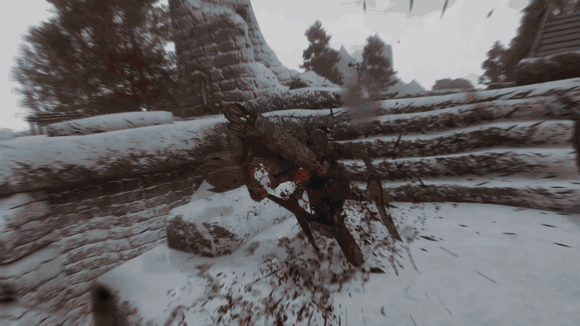
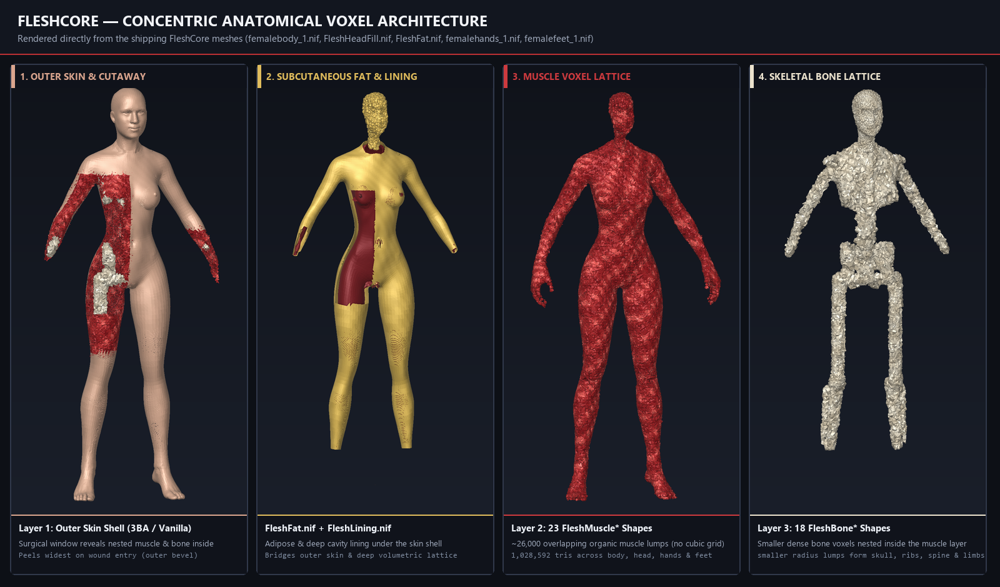
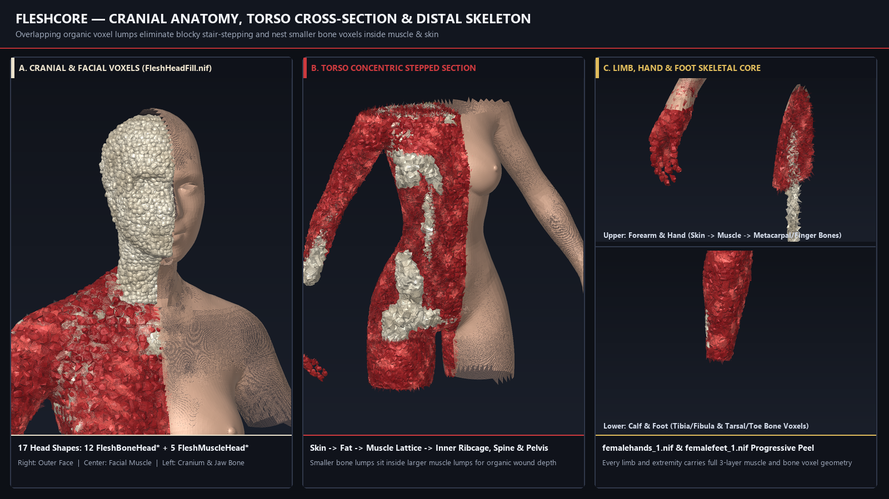
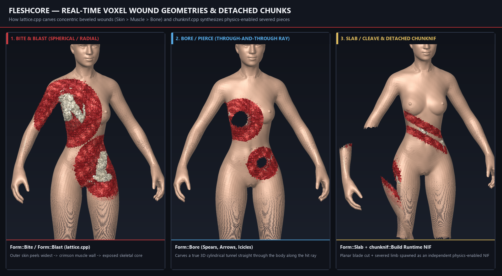
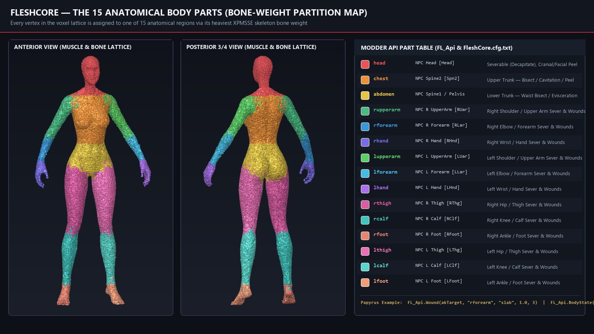
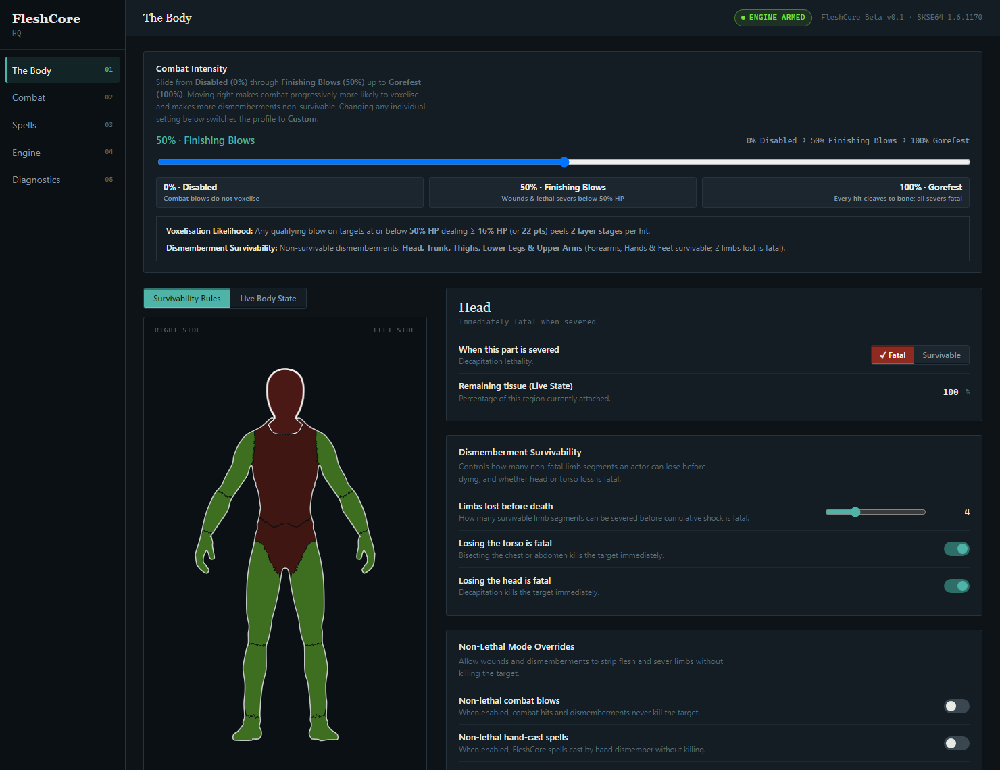
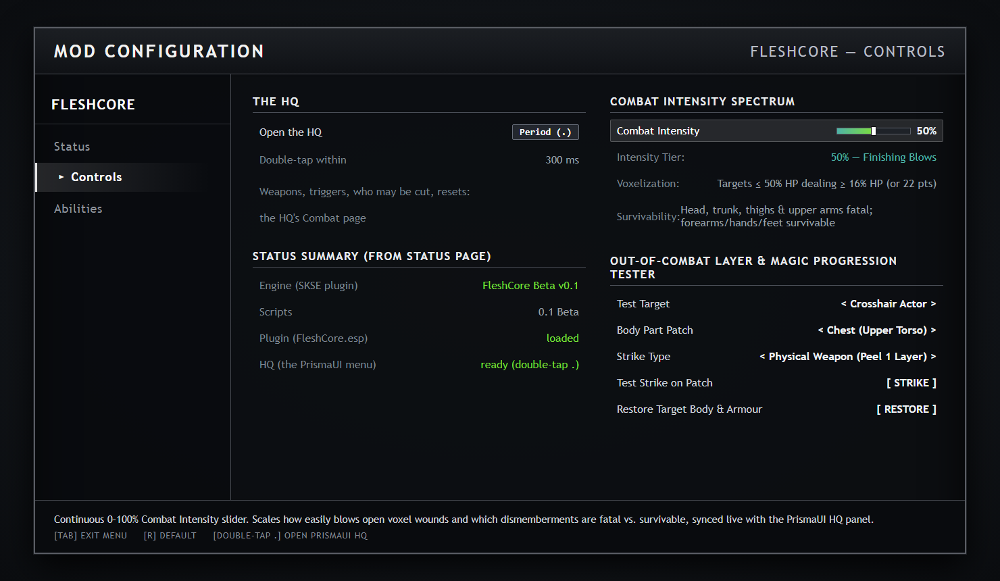

# FleshCore (Beta v0.1)

**Real-time volumetric dismemberment, layered anatomical wounds, and physics-enabled severed body parts for Skyrim Special Edition (1.6.1170), with full in-game customization and a zero-dependency Papyrus API (`FL_Api`) for other modders.**

> **Content Warning (18+ Gore):** FleshCore renders graphic anatomical gore (skin, subcutaneous fat, muscle, and bone excavation).
>
> **Beta Release (`Beta v0.1`):** This is the first public beta release of FleshCore. Expect rough edges as edge cases across custom outfits and load orders are refined.

---

## Overview & How FleshCore Works

[](https://tacticalcoconut.github.io/FleshCore/trailer.html)

Unlike traditional dismemberment mods that swap pre-made limb stumps at fixed skeleton joints, **FleshCore** turns playable-race characters into a live 3D anatomical volume built directly from their equipped body and armor meshes when they load or take a hit.

Every point of an actor's body tracks **five concentric anatomical layers** from the outside in:

| Layer | Mesh Source | Role in Combat & Wounds |
| :--- | :--- | :--- |
| **1. Armor & Clothing** | Worn outfit meshes | Outer garments and armor covering that specific patch of the body |
| **2. Skin** | Actor's body & head skin | Outer surface shell; peels widest around the edges of a wound |
| **3. Fat & Lining** | `FleshFat.nif` / `FleshLining.nif` | Subcutaneous fat and deep cavity lining directly beneath the skin |
| **4. Muscle** | `FleshMuscle*` shapes | ~26,000 overlapping 3D muscle structures filling the torso, limbs, and head |
| **5. Skeleton / Bone** | `FleshBone*` shapes | Smaller, high-density bone structures (ribs, spine, skull, limb bones) nested inside the muscle layer |

### Concentric Anatomical Voxel Architecture



### Cranial Anatomy, Stepped Torso Cross-Section & Distal Skeleton

FleshCore's anatomical interior (`FleshCore.fill.bin` / `FleshCore.fillm.bin` and `FleshHeadFill.nif`) is built from overlapping 3D muscle and skeletal bone structures beneath the skin and subcutaneous fat layers. Smaller, high-density bone structures are nested inside larger muscle structures, so any cut naturally exposes a concentric anatomical cross-section of **Skin -> Fat -> Muscle -> Bone**:



---

## Real-Time Wound Shapes & Dynamic Weapon-Angle Blade Slices

When a weapon swing, arrow, spell, or mod API call strikes an actor, FleshCore shapes the wound to match the attack:

1. **Dynamic 3D Blade Slices (`Slash` / `Cleave` / `Bisect`)**:
   - **Live Weapon-Angle Reading**: When you strike with a bladed weapon (dagger, one-handed sword, war axe, battleaxe, or greatsword), FleshCore reads the live 3D angle of your weapon blade at the moment of impact. Horizontal slashes cut horizontally, diagonal swings slice diagonally, and overhead chops cleave along the vertical plane of the swing.
   - **Per-Weapon Cut Reach**: Cut width scales automatically with the size of the blade — daggers leave tight nicks, one-handed swords and war axes gash the torso or sever an arm or leg, battleaxes deliver heavy chops, and greatswords cleave wide enough to bisect a torso.
2. **Crushing Craters (`Bite` / `Blast` — Blunt Weapons & Explosions)**:
   - Maces, warhammers, shield bashes, and explosive spells carve a concentric crater where outer skin peels wider than muscle, exposing deeper bone at the center of impact.
3. **Piercing Tunnels (`Bore` — Arrows, Bolts & Ice Spikes)**:
   - Projectiles bore a narrow cylindrical tunnel straight through the body along the flight path of the shot.
4. **Progressive Elemental Peeling (`Fire`, `Frost`, `Shock`, `Shouts`)**:
   - Hostile magic strips layers progressively (`Armor -> Skin -> Muscle -> Bone`) across the struck region.
5. **Detached Physics Pieces**:
   - Any limb, head, torso half, or chunk of flesh completely separated from the body is forged on the fly into a physics-enabled 3D piece that drops to the ground while the victim's live body mesh updates in place.



---

## The 15 Anatomical Body Parts

Every part of an actor's body is mapped to one of **15 anatomical regions** using their skeleton bone weights, allowing targeted limb loss, decapitation, torso bisection, and per-part survivability rules:



---

## In-Game Menus, Preset Slider & Full Configurability

FleshCore includes both a dedicated **PrismaUI HQ Panel** (opened anytime in-game by **double-tapping `.`**) and a **SkyUI Mod Configuration Menu (MCM)**. Both menus stay synced in real time.

### Convenient 0–100% Combat Intensity Preset Slider + Deep Customization
- **One-Slider Convenience (`0%` to `100%`)**: Drag the **Combat Intensity** slider (or click a preset tier from **0% Disabled** through **50% Finishing Blows** up to **100% Gorefest**) to automatically tune how easily blows open wounds, how many layers each hit peels, and which dismemberments are fatal vs. survivable.
- **Granular Per-Part & Per-Weapon Controls**: Tweak any setting individually to switch to a **Custom** profile:
  - Click any of the **15 body regions** on the interactive anatomical diagram to set whether severing that specific part is **Fatal** or **Survivable** (for example, allowing enemies to keep fighting after losing a hand or forearm).
  - Set how many survivable limb segments an actor can lose before dying of shock, or enable **Non-Lethal Mode** so dismemberments never kill.
  - Customize damage thresholds, health-percentage gates, weapon cut reach, per-element magic behavior, who can be cut (NPCs, followers, essential NPCs, or the player), automatic wound healing timers, and ground piece limits.
  - Use the built-in **Out-of-Combat Strike Tester** to test weapon or magic cuts on any body part of the crosshair NPC and restore them with one click.

### PrismaUI HQ Panel (Double-Tap `.` In-Game)



### SkyUI Mod Configuration Menu (MCM)



---

## Requirements & Mod Compatibility

### Hard Requirements
- **Skyrim Special Edition / Anniversary Edition `1.6.1170`** *(FleshCore's SKSE DLL verifies runtime `1.6.1170` at load and refuses other versions)*
- **[SKSE64](https://skse.silverlock.org/)** (`2.2.6` or newer)
- **[PapyrusUtil SE](https://www.nexusmods.com/skyrimspecialedition/mods/13048)**
- **[powerofthree's Papyrus Extender](https://www.nexusmods.com/skyrimspecialedition/mods/22854)**
- **[PrismaUI](https://www.nexusmods.com/skyrimspecialedition/mods/140844)** — Powers the interactive in-game **FleshCore HQ** control panel (double-tap `.` in game)
- **[SkyUI](https://www.nexusmods.com/skyrimspecialedition/mods/12604)** — For the SkyUI MCM configuration pages
- **[RaceMenu](https://www.nexusmods.com/skyrimspecialedition/mods/19080)** — For surface blood/decal overlay support (`DC_Api`)

### Combat, Animation & Body Mod Compatibility

FleshCore hooks hit events passively through SKSE without editing vanilla weapon records or behavior graphs, making it compatible with modern combat setups:

| Mod / Category | Compatibility | Notes |
| :--- | :---: | :--- |
| **Vanilla Skyrim Combat** | **Compatible** | Works out of the box with all vanilla first-person and third-person attacks, power attacks, bows, crossbows, and spells. |
| **Precision (Accurate Melee Collisions)** | **Compatible (Recommended)** | Precision passes the exact 3D point where your blade contacts the target's body directly into Skyrim's hit data, which FleshCore uses as the exact center of the cut. |
| **Attack Animation Frameworks (`MCO / ADXP`, `BFCO`, `SCAR`, `OAR`, `DAR`)** | **Compatible** | Custom attack animations fire standard hit events and update the weapon node transform normally, so dynamic blade angles and cuts work seamlessly. |
| **Combat Overhauls (`Valhalla Combat`, `Wildcat`, `Smilodon`, `Blade & Blunt`)** | **Compatible** | FleshCore never alters weapon damage, stamina costs, timed blocks, or stagger; it reads final hit damage after your combat mods calculate it. |
| **Custom Weapon Packs (`Animated Armoury`, `Heavy Armory`, etc.)** | **Compatible** | Weapons are classified automatically by their weapon animation type (dagger, sword, war axe, greatsword, battleaxe, mace, warhammer, bow, crossbow). |
| **Skeletons, Body Replacers & Outfits (`XPMSSE`, `CBBE 3BA`, `BHUNP`, `HIMBO`)** | **Compatible** | FleshCore builds its 3D lattice directly from the actor's live skinned body and outfit meshes. |
| **Acheron & Frozen Electrocuted Combustion (`FEC`)** | **Compatible** | Explicitly detected at runtime so defeat states and elemental death effects do not conflict with FleshCore wounds. |
| **Dismembering Framework (`DF`)** | **Soft-Compatible (Caveat)** | Can coexist in the same load order, *provided* both mods do not attempt to dismember the exact same human NPC on the same hit (DF swaps limbs with stump armor pieces, which conflicts if applied to a limb FleshCore is actively carving). |
| **Maximum Carnage (`MC`) / Next-Gen Decapitations** | **Incompatible on Same Target** | Maximum Carnage replaces the victim's entire 3D body with pre-made gore meshes on death, which overwrites FleshCore's live mesh wounds on that actor. |

---

## Installation (Players)

1. Download **`FleshCore.zip`** from the **Releases** page.
2. Open your Mod Manager of choice (**Mod Organizer 2** or **Vortex**), choose **Install from Archive**, and select **`FleshCore.zip`**.
3. Enable **FleshCore** in your mod list and ensure both **`FleshCore.esp`** and **`FleshCore - Skin Fill.esp`** are enabled in your plugin load order.
4. **In-Game Controls**:
   - **Double-tap `.` (Period key)** at any time in game to open the **FleshCore HQ** panel (requires PrismaUI) — drag the **Combat Intensity** preset slider or customize per-part survivability, weapon triggers, actor restoration, and optional test spells.
   - Or open **Pause Menu -> Mod Configuration -> FleshCore** (requires SkyUI).
   - *Note:* No debug spells are added to the player's spellbook automatically; you can grant or revoke any of the test spells from the HQ panel or MCM.

---

## Documentation for Modders (`FL_Api`)

Other mods can trigger wounds, sever limbs, restore actors, query anatomical state, and subscribe to real-time dismemberment ModEvents through a single global script — **`FL_Api`** — with **no master file (`FleshCore.esp` is not required as a master)** and **no hard dependency**.

- **Full Developer Reference**: See **[FleshCore-API.md](FleshCore-API.md)** for the complete reference covering every function, wound form, body-part token, ModEvent signature, and configuration command.
- **Working Consumer Example**: See **[`scripts/source/FleshCore_Example.psc`](scripts/source/FleshCore_Example.psc)**.

### Quick-Start Papyrus Examples

#### 1. Checking Eligibility & Opening Wounds
```papyrus
; Soft-check whether FleshCore is loaded and the target can be cut:
If Game.IsPluginInstalled("FleshCore.esp") && FL_Api.CoreActive() && FL_Api.Targetable(akTarget)

    ; Named presets:
    FL_Api.Wound(akTarget, "decapitate")
    FL_Api.Wound(akTarget, "bisect")
    FL_Api.Wound(akTarget, "gut")

    ; Custom anatomical wound: part, form, radiusScale, depth (1=skin, 2=+muscle, 3=+bone)
    FL_Api.Wound(akTarget, "rforearm", "slab", 1.0, 3)
    FL_Api.Wound(akTarget, "chest", "bore", 1.2, 3)

    ; Restore an actor's entire body and reverse any FleshCore wounds:
    FL_Api.Restore(akTarget)
EndIf
```

#### 2. Querying an Actor's Anatomical State
```papyrus
If FL_Api.HasAnyWound(akTarget)
    If !FL_Api.HasPart(akTarget, "head")
        Debug.Trace("Target has been decapitated!")
    EndIf
    Float chestBoneLeft = FL_Api.PartIntegrity(akTarget, "chest", 3) ; 0.0 .. 1.0
    String summary      = FL_Api.DescribeWounds(akTarget)            ; e.g. "missing the left hand, cut on the chest"
EndIf
```

#### 3. Listening to FleshCore ModEvents
```papyrus
Event OnInit()
    RegisterForModEvent("FleshCore_OnWound", "OnFleshCoreWound")
    RegisterForModEvent("FleshCore_OnSever", "OnFleshCoreSever")
    RegisterForModEvent("FleshCore_OnDeath", "OnFleshCoreDeath")
    RegisterForModEvent("FleshCore_OnRestore", "OnFleshCoreRestore")
EndEvent

Event OnFleshCoreSever(Form akVictim, String asPart, Float afRemaining)
    Actor victim = akVictim as Actor
    ; asPart is one of the 15 part names ("head", "rforearm", "lthigh", etc.)
EndEvent
```

---

## Repository Layout & Building from Source

| Path | Description |
| :--- | :--- |
| [`src/`](src/) | C++17 SKSE plugin source (`flesh.cpp`, `lattice.cpp`, `chunknif.cpp`, `windiag.cpp`, `facts.h`, `armour_bits.h`, `redraw_bits.h`, `blobs.h`) |
| [`scripts/source/`](scripts/source/) | Papyrus `.psc` source scripts (`FL_Api.psc`, `FL_Watch.psc`, `FL_MCM.psc`, `FL_Wound.psc`, `FL_Chunk.psc`, `DC_Api.psc`, etc.) |
| [`PrismaUI/views/FleshCore/`](PrismaUI/views/FleshCore/) | Interactive FleshCore HQ single-page UI (`index.html`) |
| [`SKSE/Plugins/FleshCore.cfg.txt`](SKSE/Plugins/FleshCore.cfg.txt) | Default combat trigger, anatomical threshold, and engine configuration |
| [`FleshCore-API.md`](FleshCore-API.md) | Complete modder API documentation |
| [`docs/ARCHITECTURE.md`](docs/ARCHITECTURE.md) | Engine & script bridge architecture overview |
| [`docs/BUILDING.md`](docs/BUILDING.md) | Step-by-step build instructions for the C++17 DLL, Papyrus scripts, and unit tests |
| [`test/`](test/) | Standalone C++ unit tests (`trunk_test.cpp`, `blast_test.cpp`) for the voxel lattice |

*(Binary `.nif` meshes, `.dds` textures, `.esp` plugins, and `.fill.bin` voxel payloads are packaged inside **`FleshCore.zip`** on the Releases page.)*
