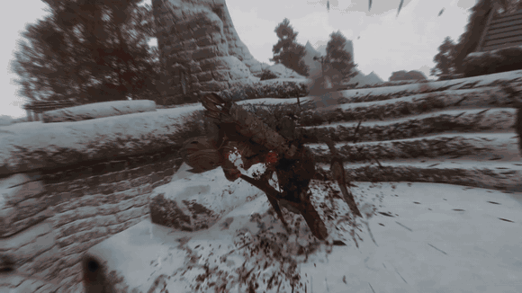
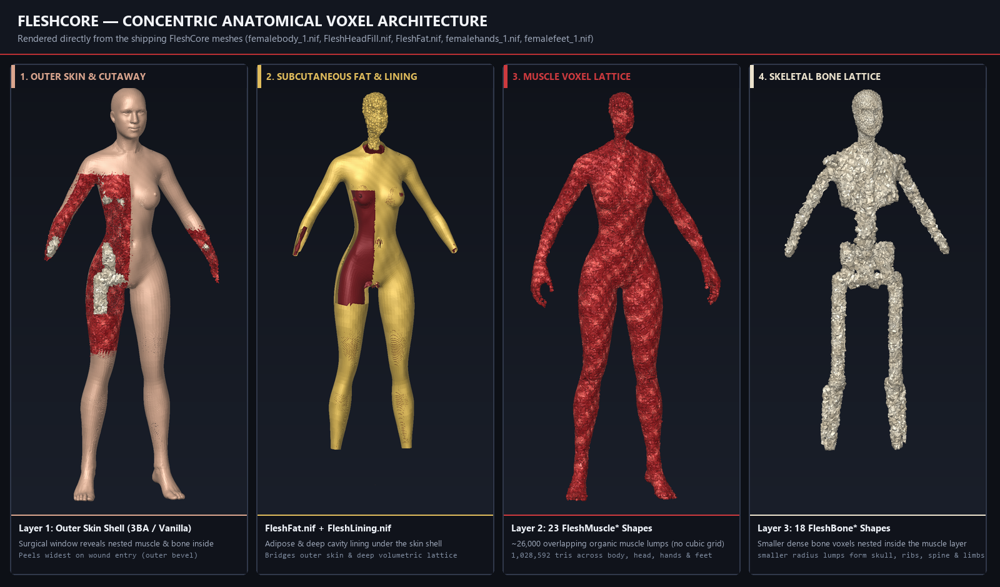
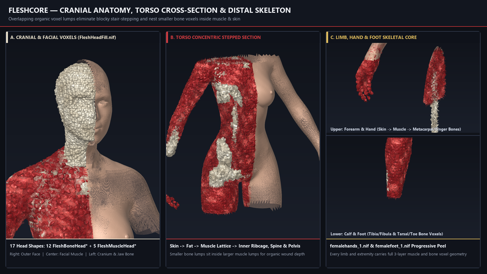
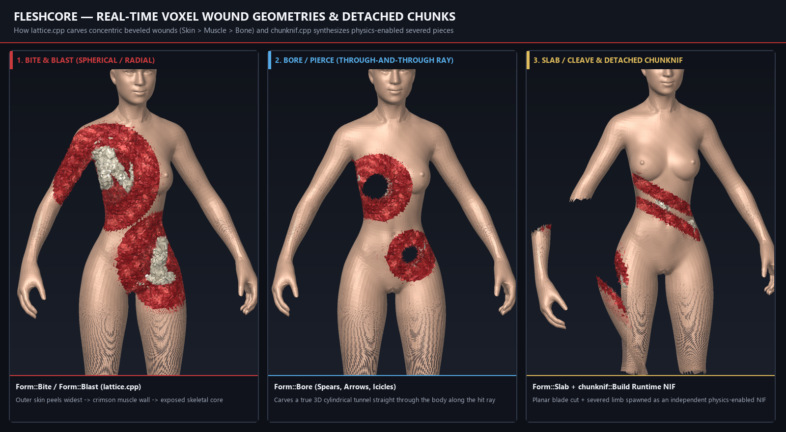
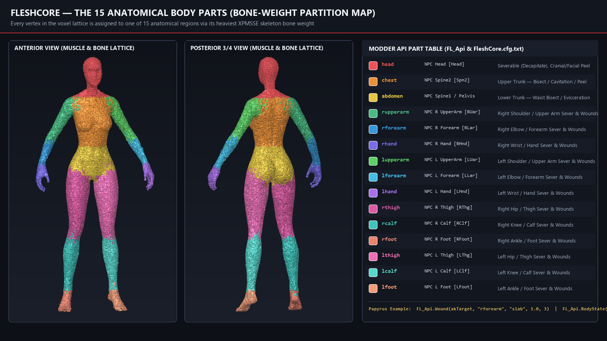
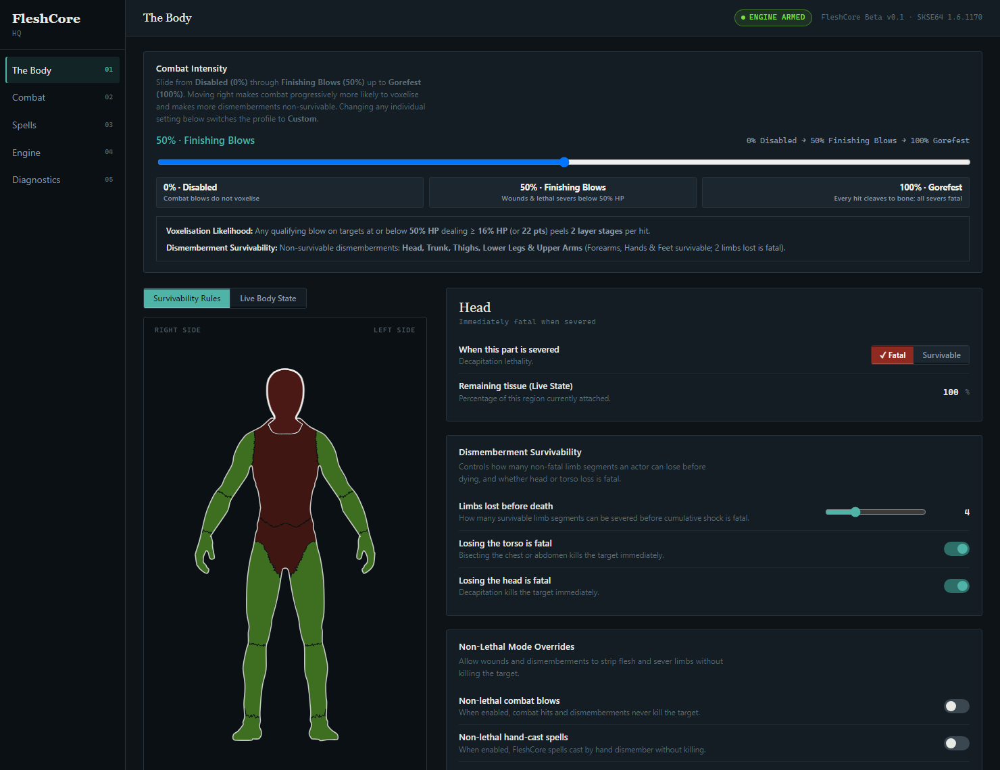
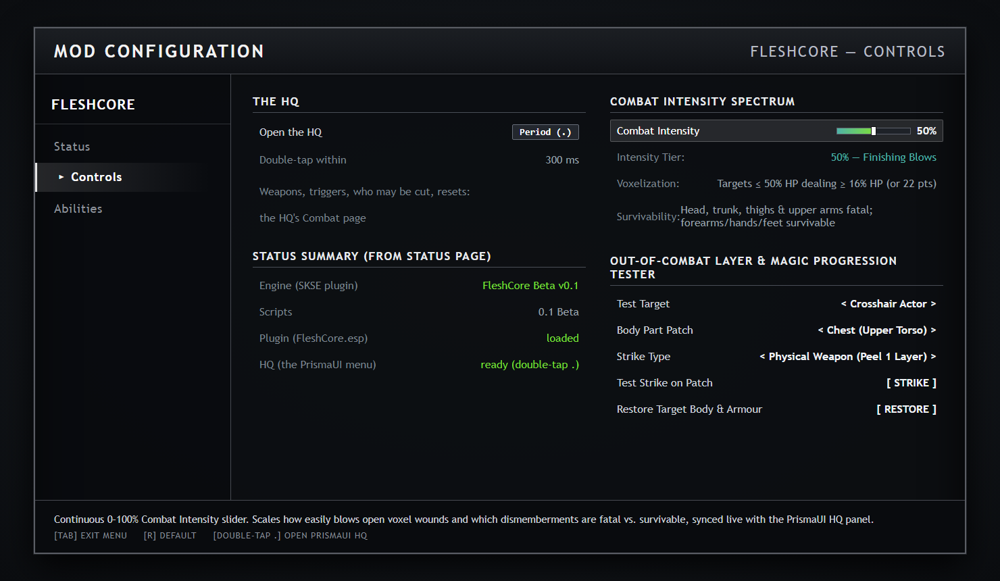

# FleshCore (Beta v0.2.0)

**Real-time volumetric dismemberment, layered anatomical wounds, and physics-enabled severed body parts for Skyrim Special Edition (Steam 1.6.1170 only), with full in-game customization and a Papyrus API (`FL_Api`) that other mods can call without making `FleshCore.esp` a master.**

> **Content Warning (18+ Gore):** FleshCore renders graphic anatomical gore (skin, subcutaneous fat, muscle, and bone excavation).
>
> **Beta Release (`Beta v0.2.0`):** This is a public beta release of FleshCore. Expect rough edges as edge cases across custom outfits and load orders are refined.

> **Disclaimer: This Mod was made with the assistance of AI Code Generation.

---

## Overview & How FleshCore Works

[](https://tacticalcoconut.github.io/FleshCore/trailer.html)

Unlike traditional dismemberment mods that swap pre-made limb stumps at fixed skeleton joints, **FleshCore** turns playable-race characters into a live 3D anatomical volume built directly from their equipped body and armor meshes when they load or take a hit.

Every point of an actor's body tracks **five concentric anatomical layers** from the outside in:

| Layer | Mesh Source | Role in Combat & Wounds |
| :--- | :--- | :--- |
| **1. Armor & Clothing** | Worn outfit meshes | Outer garments and armor covering that specific patch of the body |
| **2. Skin** | Actor's body & head skin | Outer surface shell; peels widest around the edges of a wound |
| **3. Fat & Lining** | `FleshFat.nif` / `FleshLining.nif` | Subcutaneous fat and deep cavity lining directly beneath the skin |
| **4. Muscle** | `FleshMuscle*` shapes | ~26,000 overlapping 3D muscle structures filling the torso, limbs, and head |
| **5. Skeleton / Bone** | `FleshBone*` shapes | Smaller, high-density bone structures (ribs, spine, skull, limb bones) nested inside the muscle layer |

### Concentric Anatomical Voxel Architecture



### Cranial Anatomy, Stepped Torso Cross-Section & Distal Skeleton

FleshCore's anatomical interior (`FleshCore.fill.bin` / `FleshCore.fillm.bin` and `FleshHeadFill.nif`) is built from overlapping 3D muscle and skeletal bone structures beneath the skin and subcutaneous fat layers. Smaller, high-density bone structures are nested inside larger muscle structures, so any cut naturally exposes a concentric anatomical cross-section of **Skin -> Fat -> Muscle -> Bone**:



---

## Real-Time Wound Shapes & Dynamic Weapon-Angle Blade Slices

When a weapon swing, arrow, spell, or mod API call strikes an actor, FleshCore shapes the wound to match the attack:

1. **Dynamic 3D Blade Slices (`Slash` / `Cleave` / `Bisect`)**:
   - **Live Weapon-Angle Reading**: When you strike with a bladed weapon (dagger, one-handed sword, war axe, battleaxe, or greatsword), FleshCore reads the live 3D angle of your weapon blade at the moment of impact. Horizontal slashes cut horizontally, diagonal swings slice diagonally, and overhead chops cleave along the vertical plane of the swing.
   - **Per-Weapon Cut Reach**: Cut width scales automatically with the size of the blade — daggers leave tight nicks, one-handed swords and war axes gash the torso or sever an arm or leg, battleaxes deliver heavy chops, and greatswords cleave wide enough to bisect a torso.
2. **Crushing Craters (`Bite` / `Blast` — Blunt Weapons & Explosions)**:
   - Maces, warhammers, shield bashes, and explosive spells carve a concentric crater where outer skin peels wider than muscle, exposing deeper bone at the center of impact.
3. **Piercing Tunnels (`Bore` — Arrows, Bolts & Ice Spikes)**:
   - Projectiles bore a narrow cylindrical tunnel straight through the body along the flight path of the shot.
4. **Progressive Elemental Peeling (`Fire`, `Frost`, `Shock`, `Shouts`)**:
   - Hostile magic strips layers progressively (`Armor -> Skin -> Muscle -> Bone`) across the struck region.
5. **Detached Physics Pieces**:
   - Any limb, head, torso half, or chunk of flesh completely separated from the body is forged on the fly into a physics-enabled 3D piece that drops to the ground while the victim's live body mesh updates in place.



---

## The 15 Anatomical Body Parts

Every part of an actor's body is mapped to one of **15 anatomical regions** using their skeleton bone weights, allowing targeted limb loss, decapitation, torso bisection, and per-part survivability rules:



---

## In-Game Menus, Preset Slider & Full Configurability

FleshCore includes both a dedicated **PrismaUI HQ Panel** (opened anytime in-game by **double-tapping `.`**) and a **SkyUI Mod Configuration Menu (MCM)**. Both menus stay synced in real time.

### Convenient 0–100% Combat Intensity Preset Slider + Deep Customization
- **One-Slider Convenience (`0%` to `100%`)**: Drag the **Combat Intensity** slider (or click a preset tier from **0% Disabled** through **50% Finishing Blows** up to **100% Gorefest**) to automatically tune how easily blows open wounds, how many layers each hit peels, and which dismemberments are fatal vs. survivable.
- **Granular Per-Part & Per-Weapon Controls**: Tweak any setting individually to switch to a **Custom** profile:
  - Click any of the **15 body regions** on the interactive anatomical diagram to set whether severing that specific part is **Fatal** or **Survivable** (for example, allowing enemies to keep fighting after losing a hand or forearm).
  - Set how many survivable limb segments an actor can lose before dying of shock, or enable **Non-Lethal Mode** so dismemberments never kill.
  - Customize damage thresholds, health-percentage gates, weapon cut reach, per-element magic behavior, who can be cut (NPCs, followers, essential NPCs, or the player), automatic wound healing timers, and ground piece limits.
  - Use the built-in **Out-of-Combat Strike Tester** to test weapon or magic cuts on any body part of the crosshair NPC and restore them with one click.

### PrismaUI HQ Panel (Double-Tap `.` In-Game)



### SkyUI Mod Configuration Menu (MCM)



---

## Requirements & Mod Compatibility

### Hard Requirements
- **Skyrim Special Edition / Anniversary Edition `1.6.1170`, Steam version only** — FleshCore's SKSE plugin is made for this one game version. SKSE will not start it on Skyrim `1.7.x`, on older `1.6` builds or on SE `1.5.97`, SKSE's GOG builds disable it, and the GOG version is not supported. There is no build for `1.7.x`: if Steam has updated your game past `1.6.1170`, FleshCore's SKSE plugin will not load, and nothing is cut, until the game is back on `1.6.1170`.
- **[SKSE64](https://skse.silverlock.org/) `2.2.6`, Steam build** — The build FleshCore is tested with. Get the Steam build of `2.2.6` from the SKSE site's archived builds or from [GitHub](https://github.com/ianpatt/skse64/releases/tag/v2.2.6), not SKSE `2.3.x` and not the GOG build of `2.2.6`: SKSE `2.3.x` is for Skyrim `1.7.x` and will not start `1.6.1170`, and the GOG build is made for the GOG version of the game, not the Steam one.
- **[Address Library for SKSE Plugins](https://www.nexusmods.com/skyrimspecialedition/mods/32444)** (the All in One file; it must include `versionlib-1-6-1170-0.bin`) — PapyrusUtil, powerofthree's Papyrus Extender and PrismaUI need it. FleshCore's own DLL does not use it: it hard-codes engine addresses for Steam `1.6.1170`, so Address Library cannot make FleshCore run on another game version.
- **[XP32 Maximum Skeleton Special Extended (XPMSSE)](https://www.nexusmods.com/skyrimspecialedition/mods/1988)** — FleshCore's included bodies are rigged to extended bones that XPMSSE's skeleton has and the vanilla skeleton lacks.
- **[PapyrusUtil SE](https://www.nexusmods.com/skyrimspecialedition/mods/13048)**
- **[powerofthree's Papyrus Extender](https://www.nexusmods.com/skyrimspecialedition/mods/22854)**
- **[PrismaUI](https://www.nexusmods.com/skyrimspecialedition/mods/148718)** — Powers the interactive in-game **FleshCore HQ** control panel (double-tap `.` in game)
- **[SkyUI](https://www.nexusmods.com/skyrimspecialedition/mods/12604)** — For the SkyUI MCM configuration pages
- **[RaceMenu](https://www.nexusmods.com/skyrimspecialedition/mods/19080)** — For surface blood/decal overlay support (`DC_Api`)
  - *Tip:* blood and decal marks are drawn in RaceMenu's overlay slots, and RaceMenu's defaults are small (6 for the body, 3 each for hands, feet and face). To let more marks show at once, and leave room for other overlay mods, raise `iNumOverlays` in RaceMenu's `SKSE\Plugins\skee64.ini`: for example `16` under `[Overlays/Body]` and `13` under `[Overlays/Hands]`, `[Overlays/Feet]` and `[Overlays/Face]`. FleshCore does not change this file itself.

If a requirement's page or its installer offers different files or options for different game versions, take the one for the Steam version of Skyrim `1.6.1170`.

### Optional: the Grinder Spells (need Leash Framework)
- **[Leash Framework](https://www.nexusmods.com/skyrimspecialedition/mods/187303)** `1.1.8` — Only for FleshCore's two grinder spells. FleshCore works without it, and `FleshCore.esp` does not need it to load.
  - **Spawn Grinder** puts a grinder with two spiked rollers in front of you. Aim at its base and activate it to switch it on or off. Casting it again moves the grinder: there is one at a time.
  - **Grinder Hook** chains the one you hit to the nearest grinder (in the same cell, within 2,500 units) and pulls them in. When they reach the spinning rollers, FleshCore grinds them. If the pull gets stuck, the hook's winch drags them the rest of the way. Someone the chain cannot hold (a creature has no neck bone for it) is dragged in by the winch from the start.
  - With Leash Framework installed, both spells are added to your Conjuration spells. Turn them off or on in the MCM: **Controls**, **Grinder Spells**. Without Leash Framework the spells are not added, and the MCM row says "Requires Leash Framework".
  - **Rollers grind bystanders** (MCM, off by default): anyone else who touches the spinning rollers is ground too, except you, your followers and anyone the game protects.
  - Tested with Leash Framework `1.1.8`. A newer version is used, not refused: FleshCore says once that it was not tested with it.

### Body Mods (Read Before Installing)

FleshCore includes its own bodies with muscle and bone built in: a female body built from a BodySlide set that comes with a **CBBE 3BA** add-on (not with CBBE 3BA itself) and a male body built from a **HIMBO** BodySlide set. Their hands and feet are included too, with muscle but no bone. FleshCore's bodies are nude: they carry no underwear shapes, and the male body (HIMBO's version for genital add-ons) is open at the groin, so naked men show that opening unless something covers it, such as a genital add-on. The female body also uses textures FleshCore does not include: CBBE 3BA's `femalebody_etc_v2_1` textures and the `textures\dw\ubeanus\` textures from that CBBE 3BA add-on, so install both.

- **They replace your body meshes.** These 12 files (body, hands, and feet, `_0` and `_1` each) replace the ones from your body mod and from your BodySlide output, so whichever mod wins those files decides the body of every character that uses the standard body meshes. For your characters to use FleshCore's bodies, FleshCore has to win: in MO2, place FleshCore below your body mod and your BodySlide output in the left pane (sorted by priority, the default; files in MO2's Overwrite folder always win, so move a BodySlide output there into its own mod first); in Vortex, set FleshCore to load after your body mod in the Mods tab and deploy, and because BodySlide otherwise writes its output straight into the game's Data folder, outside any Vortex mod, set BodySlide's output path to a folder you install as a mod and set FleshCore to load after that mod too. Plugin order does not decide which mod wins these files. After any later BodySlide build, check that FleshCore still wins them.
- **Body presets.** FleshCore includes no `.tri` morph files, so OBody and RaceMenu body presets use the ones in your install. The `femalebody.tri` and `malebody.tri` that come with CBBE 3BA and HIMBO do not match FleshCore's bodies (RaceMenu would apply their morphs to the wrong vertices); ones built in BodySlide, with Build Morphs on, from the same sets as FleshCore's bodies do match. The hand and feet `.tri` files that come with CBBE 3BA and HIMBO fit FleshCore's hands and feet. Body-morph presets reshape only the skin: the anatomy inside is in no `.tri` file and keeps FleshCore's own shape.
- **If your body mod wins instead,** bodies should still be cut, because FleshCore recognizes a body by its skin textures and head, not its mesh (untested). But your body meshes carry none of FleshCore's muscle or bone, and FleshCore dresses naked NPCs with its head fill only, so wounds on a naked body can show no flesh inside. Clothed NPCs are dressed with FleshCore's own interior whichever body wins.
- **Other bodies (`BHUNP`, `UNP`, and others)** have no anatomy made for them and are untested. If FleshCore wins the file conflict, every character that uses the standard body meshes gets FleshCore's bodies instead of yours.

### Combat, Animation & Body Mod Compatibility

FleshCore hooks hit events passively through SKSE without editing vanilla weapon records or behavior graphs, making it compatible with modern combat setups:

| Mod / Category | Compatibility | Notes |
| :--- | :---: | :--- |
| **Vanilla Skyrim Combat** | **Compatible** | Works out of the box with all vanilla first-person and third-person attacks, power attacks, bows, crossbows, and spells. |
| **Precision (Accurate Melee Collisions)** | **Compatible (Recommended)** | Precision passes the exact 3D point where your blade contacts the target's body directly into Skyrim's hit data, which FleshCore uses as the exact center of the cut. |
| **Attack Animation Frameworks (`MCO / ADXP`, `BFCO`, `SCAR`, `OAR`, `DAR`)** | **Compatible** | Custom attack animations fire standard hit events and update the weapon node transform normally, so dynamic blade angles and cuts work seamlessly. |
| **Combat Overhauls (`Valhalla Combat`, `Wildcat`, `Smilodon`, `Blade & Blunt`)** | **Compatible** | FleshCore never alters weapon damage, stamina costs, timed blocks, or stagger; it reads final hit damage after your combat mods calculate it. |
| **Custom Weapon Packs (`Animated Armoury`, `Heavy Armory`, etc.)** | **Compatible** | Weapons are classified automatically by their weapon animation type (dagger, sword, war axe, greatsword, battleaxe, mace, warhammer, bow, crossbow). |
| **Body Replacers (`CBBE 3BA`, `HIMBO`)** | **Built For** | FleshCore's own bodies are built from BodySlide sets for these (the female set comes with a CBBE 3BA add-on) and replace their body, hands, and feet meshes when FleshCore wins the file conflict. See **Body Mods** above. |
| **Other Body Replacers (`BHUNP`, `UNP`, etc.)** | **Untested** | No anatomy is made for them, and FleshCore's bodies replace theirs when FleshCore wins the file conflict. See **Body Mods** above. |
| **Acheron & Frozen Electrocuted Combustion (`FEC`)** | **Compatible** | Explicitly detected at runtime so defeat states and elemental death effects do not conflict with FleshCore wounds. |
| **Dismembering Framework (`DF`)** | **Soft-Compatible (Caveat)** | Can coexist in the same load order, *provided* both mods do not attempt to dismember the exact same human NPC on the same hit (DF swaps limbs with stump armor pieces, which conflicts if applied to a limb FleshCore is actively carving). |
| **Maximum Carnage (`MC`) / Next-Gen Decapitations** | **Incompatible on Same Target** | Maximum Carnage replaces the victim's entire 3D body with pre-made gore meshes on death, which overwrites FleshCore's live mesh wounds on that actor. |

---

## Installation (Players)

1. Download **`FleshCore.zip`** from the **Releases** page.
2. Open your Mod Manager of choice (**Mod Organizer 2** or **Vortex**), choose **Install from Archive**, and select **`FleshCore.zip`**.
3. **Decide which body meshes win:** FleshCore's bodies must win the file conflict with your body mod and your BodySlide output for naked characters to show FleshCore's built-in anatomy (see **Body Mods** above).
4. Enable **FleshCore** in your mod list and ensure both **`FleshCore.esp`** and **`FleshCore - Skin Fill.esp`** are enabled in your plugin load order.
5. **In-Game Controls**:
   - **Double-tap `.` (Period key)** at any time in game to open the **FleshCore HQ** panel (requires PrismaUI) — drag the **Combat Intensity** preset slider or customize per-part survivability, weapon triggers, actor restoration, and optional test spells.
   - Or open **Pause Menu -> Mod Configuration -> FleshCore** (requires SkyUI).
   - *Note:* No debug spells are added to the player's spellbook automatically; you can grant or revoke any of the test spells from the HQ panel or MCM.
6. **Updating from an earlier version:** install over it and let the new files win. On the first start, FleshCore sees that its saved list of your loose files (`SKSE\Plugins\FleshCore.loose_manifest.bin`, with MO2 in the overwrite folder) comes from the old version, does not use it, and builds a new one in the background. There is nothing to delete.

---

## Documentation for Modders (`FL_Api`)

> **Disclaimer: This Mod was made with the assistance of AI Code Generation.

Other mods can trigger wounds, sever limbs, restore actors, query anatomical state, and subscribe to real-time dismemberment ModEvents through a single global script — **`FL_Api`** — with **no master file (`FleshCore.esp` is not required as a master)** and **no hard dependency**.

- **Full Developer Reference**: See **[FleshCore-API.md](FleshCore-API.md)** for the complete reference covering every function, wound form, body-part token, ModEvent signature, and configuration command.
- **Working Consumer Example**: See **[`scripts/source/FleshCore_Example.psc`](scripts/source/FleshCore_Example.psc)**.

### Quick-Start Papyrus Examples

#### 1. Checking Eligibility & Opening Wounds
```papyrus
; Soft-check whether FleshCore is loaded and the target can be cut:
If Game.IsPluginInstalled("FleshCore.esp") && FL_Api.CoreActive() && FL_Api.Targetable(akTarget)

    ; Named wounds (the kinds are listed in FleshCore-API.md):
    FL_Api.Wound(akTarget, "decapitate")
    FL_Api.Wound(akTarget, "bisect")
    FL_Api.Wound(akTarget, "armoffl")

    ; A wound on one named part, with no record in the plugin:
    ; caller, actor, form, size, depth, part (the same columns as a trigger row)
    FL_Api.WoundPart("MyMod", akTarget, "slab", 5.0, 3, "rforearm")
    FL_Api.WoundPart("MyMod", akTarget, "bore", 7.0, 3, "chest")

    ; Put every piece of them back:
    FL_Api.Restore(akTarget)
EndIf
```

#### 2. Querying an Actor's Anatomical State
```papyrus
If FL_Api.HasBody(akTarget) && !FL_Api.IsBuiltWhole(akTarget)
    If FL_Api.PartInMask(FL_Api.GetPartsLostMask(akTarget), "head")
        Debug.Trace("The target has lost their head")
    EndIf
    Float chestLeft = FL_Api.GetPartIntegrityPct(akTarget, FL_Api.PartBit("chest")) ; 0 .. 100
    String why      = FL_Api.WhyNot(akTarget)   ; one word: why FleshCore would not wound them now
EndIf
```

#### 3. Listening to FleshCore ModEvents
```papyrus
Event OnInit()
    RegisterForModEvent("FleshCore_Wound", "OnFleshCoreWound")
    RegisterForModEvent("FL_PartLost", "OnFleshCorePartLost")
    RegisterForModEvent("FL_Restored", "OnFleshCoreRestored")
EndEvent

Event OnFleshCorePartLost(String eventName, String strArg, Float numArg, Form sender)
    Actor victim = sender as Actor
    String part = FL_Api.Field(strArg, 0)   ; one of the 15 part names ("head", "rforearm", "lthigh", ...)
EndEvent
```

#### 4. Raising the Fodder Overkill Chance for a While
```papyrus
; Add 15 points on top of the player's own Fodder Overkill setting; send 0.0 to take them away.
; One shared slot (the last mod to set it wins), kept in memory only. See FleshCore-API.md.
Game.GetPlayer().SendModEvent("FC_OverkillBonusSet", "", 15.0)
```

---

## Repository Layout & Building from Source

| Path | Description |
| :--- | :--- |
| [`src/`](src/) | C++17 SKSE plugin source (`flesh.cpp`, `lattice.cpp`, `chunknif.cpp`, `windiag.cpp`, `facts.h`, `armour_bits.h`, `redraw_bits.h`, `rawguard.h`, `blobs.h`) |
| [`scripts/source/`](scripts/source/) | Papyrus `.psc` source scripts (`FL_Api.psc`, `FL_Watch.psc`, `FL_MCM.psc`, `FL_Wound.psc`, `FL_Chunk.psc`, `DC_Api.psc`, etc.) |
| [`PrismaUI/views/FleshCore/`](PrismaUI/views/FleshCore/) | Interactive FleshCore HQ single-page UI (`index.html`) |
| [`SKSE/Plugins/FleshCore.cfg.txt`](SKSE/Plugins/FleshCore.cfg.txt) | Default combat trigger, anatomical threshold, and engine configuration |
| [`FleshCore-API.md`](FleshCore-API.md) | Complete modder API documentation |
| [`docs/ARCHITECTURE.md`](docs/ARCHITECTURE.md) | Engine & script bridge architecture overview |
| [`docs/BUILDING.md`](docs/BUILDING.md) | Step-by-step build instructions for the C++17 DLL, Papyrus scripts, and unit tests |
| [`test/`](test/) | Standalone C++ unit tests (`trunk_test.cpp`, `blast_test.cpp`) for the voxel lattice |

*(Binary `.nif` meshes, `.dds` textures, `.esp` plugins, and `.fill.bin` voxel payloads are packaged inside **`FleshCore.zip`** on the Releases page.)*
